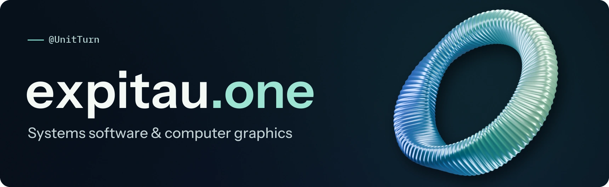

<picture>
  <source media="(max-width: 640px)" srcset="https://raw.githubusercontent.com/UnitTurn/UnitTurn/main/assets/cover-compact.webp">
  
</picture>

  <a href="https://expitau.one"><picture><source media="(max-width: 640px)"
    srcset="https://raw.githubusercontent.com/UnitTurn/UnitTurn/main/assets/website-compact.webp"></picture></a>
  <a href="mailto:hello@expitau.one"><picture><source media="(max-width: 640px)"
    srcset="https://raw.githubusercontent.com/UnitTurn/UnitTurn/main/assets/email-compact.webp"></picture></a>

## 关于我 · About

我曾是 **OpenHarmony 认证子系统**的核心贡献者。我对图形渲染、游戏开发和 AI 工作流感兴趣，也喜欢做开发工具。

I was a core contributor to the **OpenHarmony authentication subsystem**. My interests include rendering, game development, AI workflows, and developer tools.
