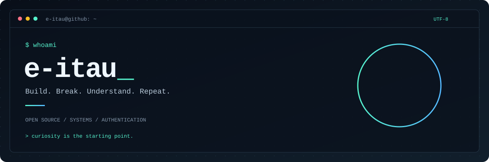

<p align="center">
  
</p>

<p align="center">
  <samp>OPEN SOURCE &nbsp; / &nbsp; SYSTEMS &nbsp; / &nbsp; AUTHENTICATION</samp>
</p>

### `$ cat about.md`

曾是 **OpenHarmony 认证子系统的核心贡献者**。  
Former core contributor to the **OpenHarmony authentication subsystem**.

从系统底层到可用的工具，保持好奇，把想法做出来。

### `$ git log --oneline --past-work`

**OpenHarmony · Identity &amp; Authentication**

| Area | Selected contributions |
| :--- | :--- |
| User authentication | [账号子系统调用适配 · !413](https://gitee.com/openharmony/useriam_user_auth_framework/pulls/413) |
| PIN authentication | [OpenSSL 静态库转动态库 · !222](https://gitee.com/openharmony/useriam_pin_auth/pulls/222) |
| Code review | [认证框架 NAPI 优化评审 · !410](https://gitee.com/openharmony/useriam_user_auth_framework/pulls/410) |

<samp>Historical contributions · Gitee: <a href="https://gitee.com/BaiWeiQiu">BaiWeiQiu</a> · Not a current maintainer</samp>

### `$ ls interests/`

`game-development/` &nbsp; `ai-workflows/` &nbsp; `developer-tools/`

### `$ cat philosophy.txt`

```text
[01] explore     追问它为什么这样工作
[02] build       把想法变成能运行的东西
[03] simplify    让复杂的系统有清晰的结构
[04] iterate     在真实反馈中持续改进
```
